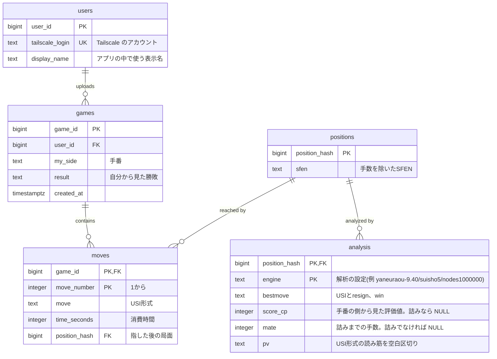

# ER図

## 各テーブルについて

| テーブル | 1行が表すもの | 主キー |
|---|---|---|
| `users` | アプリを使う人 | `user_id` |
| `games` | アップロードされた1局 | `game_id` |
| `moves` | ある対局の1手と、その手を指した後の局面 | (`game_id`, `move_number`) |
| `positions` | 1つの局面。何局に出てきても1行 | `position_hash` |
| `analysis` | ある局面を、ある設定のエンジンで解析した結果 | (`position_hash`, `engine`) |

- `analysis` を `positions` と分けるのは解析結果がエンジン・評価関数・探索の条件にも左右されるため
- 平手しか扱わないので、`games` に手合割の列は持たない

## ハッシュの型について

Zobrist ハッシュは64ビットの符号なし整数（0〜2^64−1）だが、PostgreSQL の `bigint` は符号付き（−2^63〜2^63−1）。64ビットの並びはそのままにして符号付きの数として読み替えて保存する。

- 保存するとき：2^63 以上なら 2^64 を引く
- 読み出すとき：負なら 2^64 を足す

このとき値の大小の順番は変わるが、等しいかどうかは変わらないため問題ない。

## インデックスについて

同一局面の検索に使うためmoves.position_hashにはインデックスを付ける

## ハッシュの衝突への対応

計測では、約96万の異なる局面で64ビットのハッシュの衝突は0件だった（見積もりは約 2.5×10^-8 件）。想定する規模（1,000局 × 100局面 = 10万局面）では、衝突は起きないものとして扱う。ただしpositions.sfenを使って衝突しているかを確かめることができる

## 個人情報について

元の KIF ファイルは保存しない。対局者名・対局日時・場所・コメントは、どのテーブルにも持たない。
